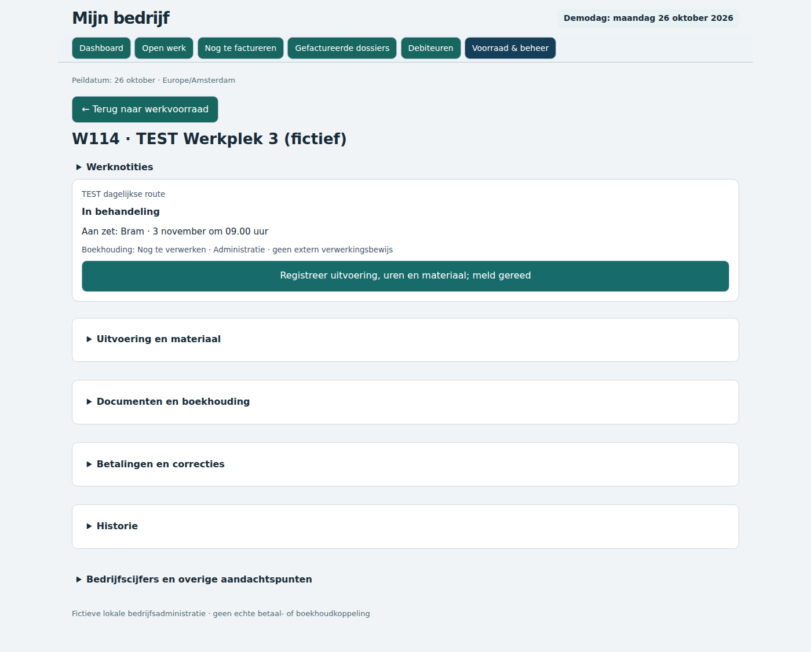
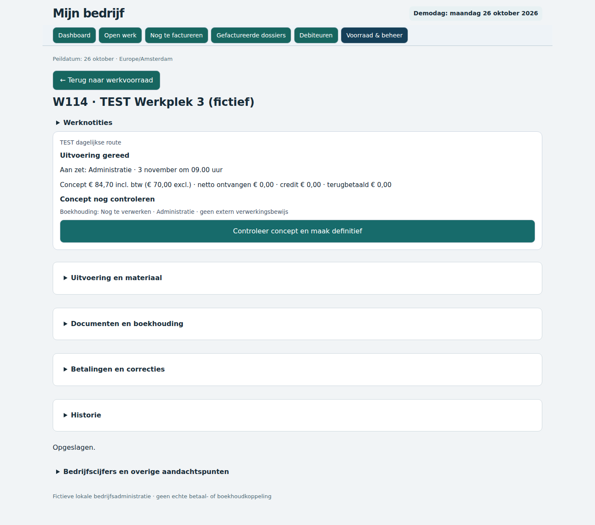
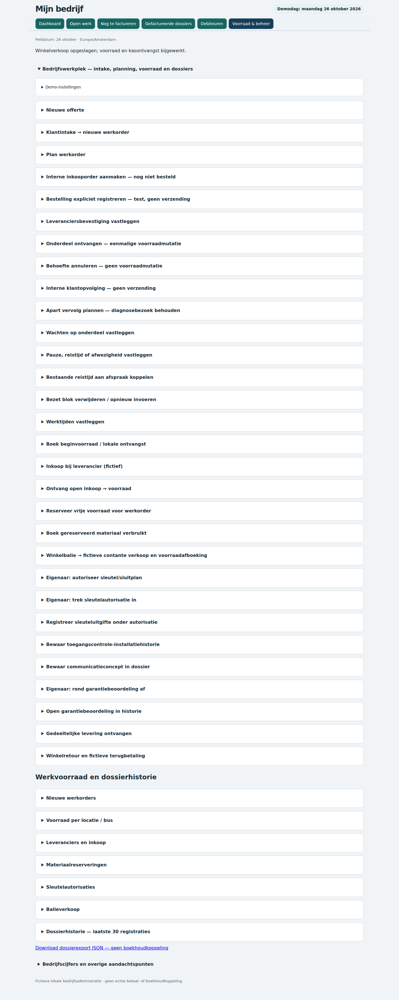

# Materiaal- en retourroute — browserbewijs

De volledige route is op fictieve testgegevens via de gebruikersinterface uitgevoerd. Elke stap is gekoppeld aan een afstemmingscontrole in step-reconciliation.jsonl. De live administratie is niet gemuteerd.

## Stap 36 — Reserveer vrije voorraad voor werkorder

## Stap 37 — Geef niet-gebruikt materiaal vrij

## Stap 39 — Reserveer vrije voorraad voor werkorder

## Stap 40 — Gebruik 1 × TEST Werkplek voorraadcilinder

## Stap 42 — Maak concept uit registratie

## Stap 68 — Winkelbalie → fictieve contante verkoop en voorraadafboeking

## Stap 70 — Winkelretour 1

## Stap 72 — Winkelretour 2

